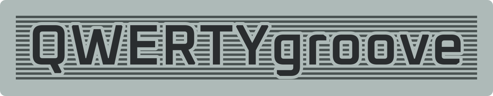
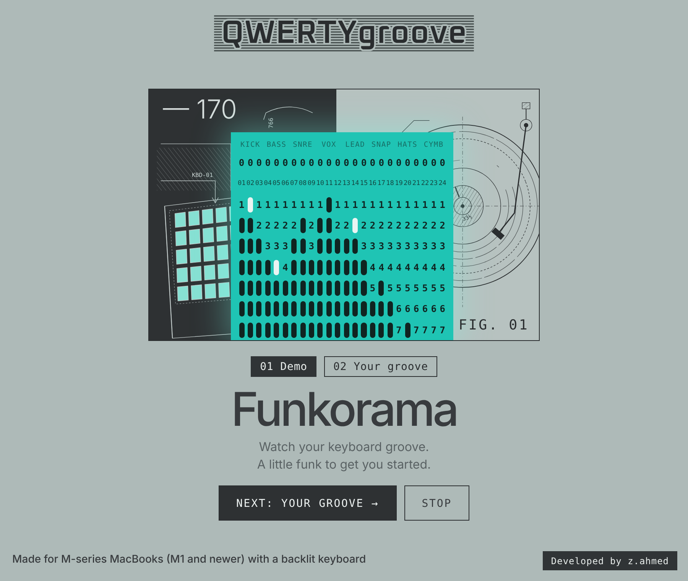

<p align="center"></p>

Hit play and let your MacBook keyboard groove along. The backlight flashes to every kick, snare and vocal, and goes dark between beats.

Works with Spotify, Apple Music, YouTube or anything else playing on your Mac, through speakers or headphones.

Best with the lights down. In a dim room the keys really pop.



## Install

Open Terminal and paste this:

```bash
curl -fsSL https://raw.githubusercontent.com/zaenae/QWERTYgroove/main/install.sh | bash
```

It asks for your Mac password once. When it's done, press Y to open it.

## Use

Type `qwertygroove` in Terminal.

It starts with a demo song. Click **Your groove**, put something on, and watch your keyboard.

## Needs

- A MacBook with a backlit keyboard (M1 or newer)
- macOS

To hear your music, the installer adds [BlackHole](https://github.com/ExistentialAudio/BlackHole), a free audio driver. Your sound still plays through your speakers or headphones as normal.

## Uninstall

```bash
rm -rf ~/.qwertygroove ~/.local/bin/qwertygroove
brew uninstall blackhole-2ch switchaudio-osx
```

## Credits

Demo song: "Funkorama" by Kevin MacLeod ([incompetech.com](https://incompetech.com)), licensed under [CC BY 4.0](https://creativecommons.org/licenses/by/4.0/). It's downloaded the first time you run the app.

## License

MIT
